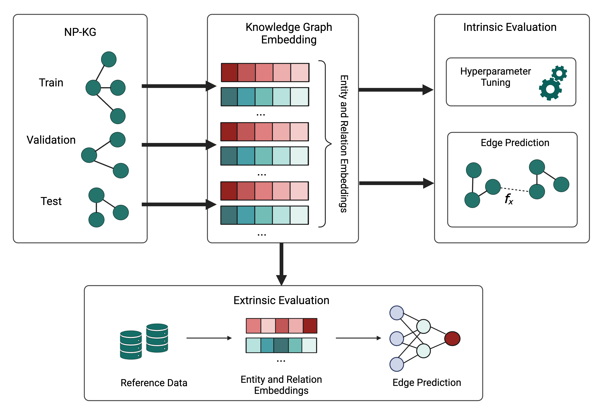

# npkg-embedding
Embeddings related scripts and notebooks for NP-KG



## Workflow

### Note: Steps 1-5 in [dglke-modeling/](https://github.com/sanyabt/npkg-embedding/tree/main/dglke-modeling) and 6-8 in [embeddings-evaluation/](https://github.com/sanyabt/npkg-embedding/tree/main/embedding-evaluation). Mechanism generation in [grape-modeling/](https://github.com/sanyabt/npkg-embedding/tree/main/grape-modeling)

1. **Split NP-KG into Train, Test, and Validation Data**:
    - Ensure the splits are connected to avoid isolated subgraphs (connected holdout)
    - Save as TSV files for train, validation, test data
    - Notebook: [process-and-split-npkg.ipynb](https://github.com/sanyabt/npkg-embedding/blob/main/dglke-modeling/process-and-split-npkg.ipynb)
    - Output: [data/](https://github.com/sanyabt/npkg-embedding/tree/main/data)
2. **Train KGE Models with DGL-KE using SLURM with default parameters**:
    - Create [SLURM job scripts](https://github.com/sanyabt/npkg-embedding/tree/main/dglke-modeling) for each model (TransE, RotatE, DistMult, ComplEx, Conv).
    - Evaluate on test data
    - Script: {model_name}_train_eval_default.slurm
    - Output: test data performance in log, embeddings in [output/](https://github.com/sanyabt/npkg-embedding/tree/main/dglke-modeling/output)
3. **HPO**
    - HPO with quasi random trials and evaluation with validation data
    - Report metrics and choose the best hyperparameters for each model based on MRR on validation data.
    - Scripts: change model name in “[hpo_model_train_script.py](https://github.com/sanyabt/npkg-embedding/blob/main/dglke-modeling/hpo_model_train_script.py)” and run “[hpo_train_validate.slurm](https://github.com/sanyabt/npkg-embedding/blob/main/dglke-modeling/hpo_train_validate.slurm)”
    - Output: best config parameters saved to log with validation MRR
4. **Intrinsic evaluation**
    - With best parameters, run models again (embeddings are not saved) and evaluate on test data.
    - Script: {model_name}_train_eval_best.slurm
    - Output: test data performance in logs
5. **Generate embeddings for all data**
    - With best parameters, run models on all data and save embeddings
    - Script: {model_name}_train_all_data.slurm
    - Output: embeddings and config saved in [output/](https://github.com/sanyabt/npkg-embedding/tree/main/dglke-modeling/output)
6. **Load embeddings and reference dataset**
    - Process and save embeddings to pickle: [load-process-embeddings.ipynb](https://github.com/sanyabt/npkg-embedding/blob/main/embedding-evaluation/load_process_embeddings.ipynb)
    - Save reference data as edges: [npkg-data-process-for-embeddings.ipynb](https://github.com/sanyabt/npkg-embedding/blob/main/npkg-data-process-for-embeddings.ipynb)
7. **Edge prediction**
    - Feature extraction methods: concatenation or hadamrd
    - 5-fold cross validation
    - Classification with logistic regression and multilayer perceptron
    - Script: [edge_prediction_embeddings_binary.py](https://github.com/sanyabt/npkg-embedding/blob/main/embedding-evaluation/edge_prediction_embeddings_binary.py)
    - Input parameters: embed_model, edge_feature, classifier, n_folds
    - Command example: ```python edge_prediction_embeddings_binary.py --embed_model ComplEx --edge_feature concat --classifier lr --output_dir results_binary/ ```
    - Output: prediction probabilities in [results_binary/](https://github.com/sanyabt/npkg-embedding/tree/main/embedding-evaluation/results_binary), edge_prediction.log
8. **Visualization**
    - Embeddings TSNE visualization for node degrees, node types, edge types, edge weights: [transe-edge-prediction-vis.ipynb](https://github.com/sanyabt/npkg-embedding/blob/main/embedding-evaluation/transe-edge-prediction-vis.ipynb)
    - Results: [plot_results.ipynb](https://github.com/sanyabt/npkg-embedding/blob/main/embedding-evaluation/plot_results.ipynb)
    - Output: [images/](https://github.com/sanyabt/npkg-embedding/tree/main/images)
9. **Mechanism Generation**
    - Mechanism Generation: [neo4j-graph-analysis](https://github.com/sanyabt/npkg-workspace/tree/main/neo4j-graph-analysis)
    - Mechanism Ranking: [generate_and_score_paths.py](https://github.com/sanyabt/npkg-embedding/blob/main/grape-modeling/generate_and_score_paths.py)
    - Mechanism Exploration
